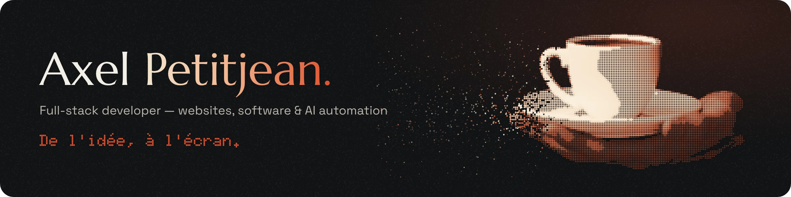

  

  

  
  
  

 

### · · · About me

- Student at **42 Perpignan** — C, C++, algorithms, systems and networks.
- Founder of **[Ourobos](https://ourobos.fr)** — custom websites, software and AI automation.

 

### · · · Stack

  
  
  
  
  
  
  
  
  
  
  
  

 

### · · · Featured projects

  
  

 

### · · · Stats

  
  

  

 

  

  

